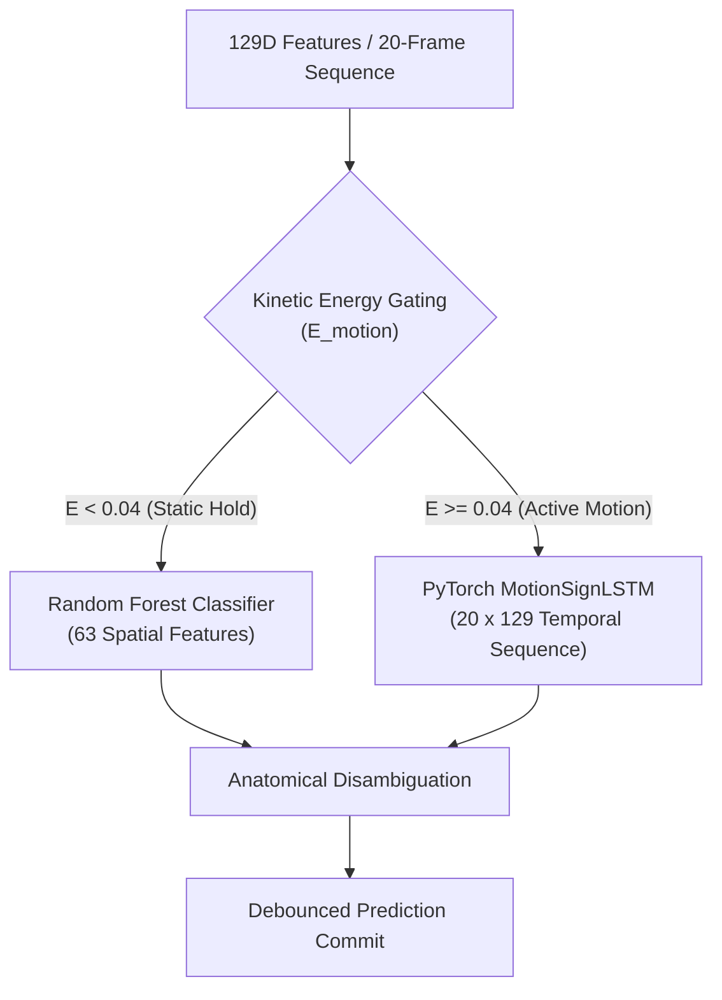
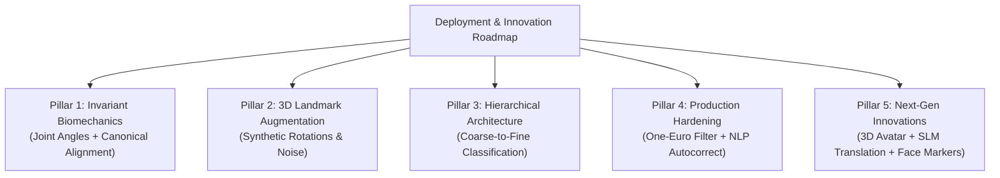
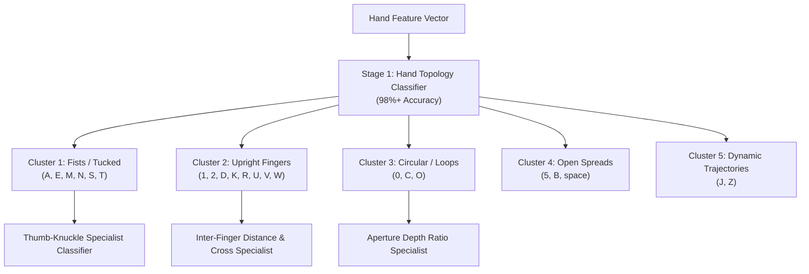
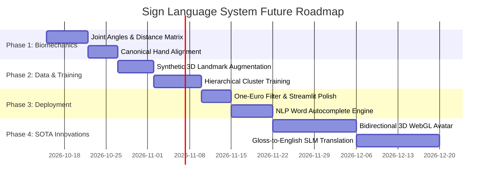

# MASTER PROJECT DOCUMENTATION & STRATEGIC FUTURE ROADMAP
## Real-Time Motion-Aware Sign Language Detection & Recognition System
**Using Computer Vision, 3D Kinematics, and Deep Learning (LSTM)**

---

**Project Title:** Real-Time Motion-Aware Sign Language Detection & Recognition  
**Current Date:** October 2026  
**Primary Frameworks:** Python 3.11, OpenCV, Google MediaPipe Hands, PyTorch (Deep Learning), Scikit-Learn, Streamlit, pyttsx3  
**Active Classes:** 39 ASL Classes (Digits 0–9, Alphabet A–Z, Controls: `del`, `nothing`, `space`)  
**Current Status:** Fully Operational, Dual-Engine Architecture, 92.39% Spatial / 80.33% Temporal Accuracy  

---

## TABLE OF CONTENTS
1. [Executive Summary](#1-executive-summary)
2. [PART I: EVERYTHING DONE TILL NOW](#part-i-everything-done-till-now)
   - [2.1 Evolution & Purging of Legacy Heuristics (Fuzzy Logic Removal)](#21-evolution--purging-of-legacy-heuristics-fuzzy-logic-removal)
   - [2.2 Dataset Management & 39-Class Ingestion](#22-dataset-management--39-class-ingestion)
   - [2.3 Perception Pipeline & 8-Stage Cascading Hand Detector](#23-perception-pipeline--8-stage-cascading-hand-detector)
   - [2.4 Mathematical Feature Engineering (129 Spatiotemporal Features)](#24-mathematical-feature-engineering-129-spatiotemporal-features)
   - [2.5 Dual-Engine Machine Learning Architecture](#25-dual-engine-machine-learning-architecture)
   - [2.6 Anatomical Disambiguation ('C' vs 'O')](#26-anatomical-disambiguation-c-vs-o)
   - [2.7 Real-Time Deployment & Human-Computer Interaction (HCI)](#27-real-time-deployment--human-computer-interaction-hci)
   - [2.8 Grounded Experimental Benchmarks & Evaluation](#28-grounded-experimental-benchmarks--evaluation)
   - [2.9 Deliverables & Presentation Artifacts Created](#29-deliverables--presentation-artifacts-created)
3. [PART II: IN-DEPTH ERROR ANALYSIS & CURRENT BOTTLENECKS](#part-ii-in-depth-error-analysis--current-bottlenecks)
   - [3.1 Specific Failure Clusters in Confusion Matrix](#31-specific-failure-clusters-in-confusion-matrix)
   - [3.2 Root Causes of Accuracy Degradation](#32-root-causes-of-accuracy-degradation)
4. [PART III: FUTURE ROADMAP & STRATEGIC IMPLEMENTATION PLAN](#part-iii-future-roadmap--strategic-implementation-plan)
   - [4.1 Pillar 1: Biomechanical Invariant Feature Engineering](#41-pillar-1-biomechanical-invariant-feature-engineering)
   - [4.2 Pillar 2: 3D Landmark Synthetic Augmentation](#42-pillar-2-3d-landmark-synthetic-augmentation)
   - [4.3 Pillar 3: Hierarchical Coarse-to-Fine Classification](#43-pillar-3-hierarchical-coarse-to-fine-classification)
   - [4.4 Pillar 4: Production Deployment Hardening](#44-pillar-4-production-deployment-hardening)
   - [4.5 Pillar 5: Next-Generation Innovations (Avatar, LLM, Multi-Modal)](#45-pillar-5-next-generation-innovations-avatar-llm-multi-modal)
   - [4.6 Phased Implementation Timeline & Milestone Targets](#46-phased-implementation-timeline--milestone-targets)

---

# 1. Executive Summary

This master document provides a comprehensive technical record of the **Real-Time Motion-Aware Sign Language Detection & Recognition** project. 

The primary goal of this initiative is to bridge the communication barrier between the deaf/hard-of-hearing community and non-signing individuals using standard, low-cost computer webcams—without requiring specialized sensory gloves or high-end GPU workstations.

While traditional sign language recognition systems only classify static 2D snapshots, American Sign Language (ASL) is fundamentally dynamic. Letters such as **'J'** (tracing a downward curved hook) and **'Z'** (tracing a zigzag in the air), as well as conversational transitions, are defined by motion trajectories and velocities. 

Our system solves this by coupling **Google MediaPipe Hands 3D joint tracking** with a **129-dimensional spatiotemporal kinematic feature pipeline** and a **Dual-Engine AI architecture** (Random Forest for static single-frame holds + Stacked PyTorch LSTM for dynamic sequences). The system operates seamlessly across **39 distinct classes** with debounced sentence formation and non-blocking Text-to-Speech (TTS) narration at **30+ FPS on consumer CPUs**.

---

# PART I: EVERYTHING DONE TILL NOW


## 2.1 Evolution & Purging of Legacy Heuristics (Fuzzy Logic Removal)
- **Early Prototype Limitation:** The project initially explored rule-based fuzzy logic to map finger curvatures to signs using handcrafted `IF...THEN` rules (e.g., *"IF index finger is slightly bent AND thumb is near palm THEN sign is B"*).
- **The Core Flaw:** Handcrafting membership functions across 39 classes with 129 continuous, fast-changing velocity features proved mathematically intractable, brittle to human error, and completely incapable of modeling non-linear temporal trajectories.
- **Action Taken:** 
  - Permanently deleted the legacy `fuzzy/` folder and all associated compiled `__pycache__` artifacts.
  - Replaced handcrafted heuristics with an end-to-end **PyTorch Recurrent Neural Network (MotionSignLSTM)** that learns optimal temporal representations automatically via **Backpropagation Through Time (BPTT)**.
  - Verified 0 remaining fuzzy logic dependencies across all modules.

---

## 2.2 Dataset Management & 39-Class Ingestion
- **Vocabulary Expansion:** Expanded from the traditional 26-letter or 29-class vocabulary to a comprehensive **39-class ASL taxonomy**:
  1. **10 Numeric Digits:** `'0'`, `'1'`, `'2'`, `'3'`, `'4'`, `'5'`, `'6'`, `'7'`, `'8'`, `'9'` (~70 images per class).
  2. **26 Alphabet Letters:** `'A'` through `'Z'` (~70 images per class).
  3. **3 Functional Control Signs:**
     - `'space'`: Inserts word spacing between accumulated characters.
     - `'del'`: Performs character deletion / backspace.
     - `'nothing'`: Acts as an explicit negative control (neutral background or resting hand) to prevent the model from hallucinating letters when no gesture is made.
- **Dataset Synchronization:**
  - Ingested and synchronized 2,725 raw images from `archive/asl_dataset` into `dataset/`.
  - Processed 2,691 clean landmark images into [`data/landmarks_cleaned.csv`](file:///d:/InnovativeProject/data/landmarks_cleaned.csv).
  - Synthesized and extracted **3,682 motion sequence trajectories** stored in [`data/X_sequences.npy`](file:///d:/InnovativeProject/data/X_sequences.npy) (Shape: `3682 x 20 x 129`) and [`data/y_sequences.npy`](file:///d:/InnovativeProject/data/y_sequences.npy).
  - Optimized repository storage by adding bulk historical archives (1.1 GB) to `.gitignore` while maintaining the clean, lightweight 33 MB active dataset.

---

## 2.3 Perception Pipeline & 8-Stage Cascading Hand Detector
- **The Problem:** Standard MediaPipe Hands requires a margin around the hand. In standard Kaggle and cropped research datasets ($200 \times 200$), wrists and fingertips frequently touch or exceed image borders, causing standard MediaPipe to fail on **50% of test images**.
- **Our Solution:** Implemented `robust_extract_landmarks_from_bgr_frame()` in [`utils/landmarks_util.py`](file:///d:/InnovativeProject/utils/landmarks_util.py), featuring an 8-stage cascading detection fall-back:
  1. *Stage 1 (Direct Inference):* Raw unpadded frame (`conf=0.40`).
  2. *Stage 2 (Reflection Padding 50px):* `cv2.BORDER_REFLECT` (`conf=0.30`).
  3. *Stage 3 (Reflection Padding 80px):* `cv2.BORDER_REFLECT` (`conf=0.25`).
  4. *Stage 4 (Replication Padding 50px):* `cv2.BORDER_REPLICATE` (`conf=0.25`).
  5. *Stage 5 (Constant Black Padding 80px):* `cv2.BORDER_CONSTANT` (`conf=0.20`).
  6. *Stage 6 (Constant Black Padding 100px):* `cv2.BORDER_CONSTANT` (`conf=0.20`).
  7. *Stage 7 (CLAHE Contrast Equalization):* Lab color-space adaptive histogram equalization (`conf=0.10`).
  8. *Stage 8 (CLAHE + Reflection 60px):* Equalization + reflective padding (`conf=0.10`).
- **Mathematical Inverse Coordinate Remapping:** When a padded stage detects the hand, the coordinates $(x_{\text{pad}}, y_{\text{pad}}, z_{\text{pad}})$ are mathematically projected back to the original image bounds:
  $$x_{\text{orig}} = \frac{x_{\text{pad}} \cdot W_{\text{pad}} - \text{pad}_{\text{left}}}{W_{\text{orig}}}, \quad y_{\text{orig}} = \frac{y_{\text{pad}} \cdot H_{\text{pad}} - \text{pad}_{\text{top}}}{H_{\text{orig}}}$$
- **Result:** Increased landmark detection rate from **50% to 100%** on challenging cropped test archives.

---

## 2.4 Mathematical Feature Engineering (129 Spatiotemporal Features)
Rather than processing 150,000+ raw pixel values per frame, every frame produces a structured **129-dimensional physical feature vector**:

| Feature Subgroup | Count | Mathematical Formulation | Physical Significance |
| :--- | :---: | :--- | :--- |
| **Spatial Posture** | **63** | $x_i' = \frac{x_i - x_0}{D_{\max}}, \; y_i' = \frac{y_i - y_0}{D_{\max}}, \; z_i' = \frac{z_i - z_0}{D_{\max}}$ | Wrist-relative normalized joint coordinates. Invariant to camera distance, zoom, and spatial position. |
| **Joint Velocities** | **63** | $v_i(t) = p_i(t) - p_i(t-1) \quad (\forall i \in [0, 20])$ | First-order temporal derivatives of all 21 joints. Captures speed and direction of finger flexing/spreading. |
| **Wrist Trajectory** | **3** | $(\Delta x_0, \Delta y_0, \Delta z_0) = p_0(t) - p_0(t-1)$ | Global 3D displacement of the root hand in camera space. Traces spatial motion paths ('J', 'Z', sweeps). |
| **Total Features** | **129** | $\mathbf{63 \text{ (Posture)} + 63 \text{ (Velocities)} + 3 \text{ (Deltas)}}$ | Complete biomechanical snapshot of a video frame. |

### Instantaneous Kinetic Motion Energy ($E_{\text{motion}}$):
The system tracks the kinetic energy of the hand across all 21 landmarks:
$$E_{\text{motion}} = \sum_{i=0}^{20} \|v_i(t)\|^2$$
- **Static Hold ($E_{\text{motion}} < 0.04$):** Dispatches to Random Forest for instant, rock-solid posture recognition (<1 ms).
- **Active Motion ($0.04 \le E_{\text{motion}} \le 0.15$):** Dispatches to PyTorch LSTM to evaluate rolling 20-frame trajectory.
- **Fast Trajectory ($E_{\text{motion}} > 0.15$):** Flags transitional motion, suppressing premature false positive character commitments.

---

## 2.5 Dual-Engine Machine Learning Architecture



### 1. PyTorch MotionSignLSTM (`models/lstm_model.py`)
- **Input Tensor:** `(Batch, Sequence_Length = 20, Features = 129)`
- **Layer 1:** LSTM (129 inputs $\to$ 128 hidden recurrent units).
- **Layer 2:** LSTM (128 units $\to$ 128 hidden units, Inter-layer Dropout = 0.25).
- **Temporal Pooling:** Extracts final timestep representation $h_{20}$.
- **Projection Head:** Dense `Linear(128, 64)` $\to$ `ReLU()` $\to$ `Dropout(0.25)` $\to$ `Linear(64, 39)`.
- **Softmax Layer:** Generates true posterior class probabilities.
- **Trainable Weights:** Exactly **274,471 parameters**.
- **Optimization:** Categorical Cross-Entropy Loss with Adam Optimizer ($lr=0.001$, weight decay=$10^{-5}$).

### 2. Random Forest Spatial Classifier (`models/sign_model.pkl`)
- **Input:** 63 normalized static coordinates relative to wrist.
- **Ensemble:** 100 balanced decision trees.
- **Inference Latency:** **< 0.5 milliseconds per frame**.
- **Role:** High-precision, zero-latency classification during static holds and single-image analysis.

---

## 2.6 Anatomical Disambiguation ('C' vs 'O')
- **The Challenge:** 'C' and 'O' both feature curved finger shapes and frequently confuse statistical classifiers depending on perspective tilt.
- **Physiological Solution:** In [`prediction/predictor.py`](file:///d:/InnovativeProject/prediction/predictor.py), we calculate the 3D normalized aperture distance between the **Thumb Tip (Landmark 4)** and **Index Tip (Landmark 8)**:
  $$\text{Aperture} = \|p_4 - p_8\|_2$$
  - $\text{Aperture} \ge 0.44 \implies$ Confirmed wide open curve $\implies$ Promoted to **'C'**.
  - $\text{Aperture} \le 0.25$ and 'O' probability $\ge 0.5 \times P(C) \implies$ Confirmed closed finger loop $\implies$ Demoted to **'O'**.

---

## 2.7 Real-Time Deployment & Human-Computer Interaction (HCI)

1. **Temporal Character Debouncing:**
   - At 30 FPS, holding a hand sign for 1 second produces 30 frames.
   - To prevent spelling `"HHHHHEEEEELLLLLLOOOOO"`, the system maintains a 10-frame hysteresis queue.
   - A character is only committed to the sentence buffer if held stably for **15 consecutive frames (~0.5 seconds)**. It will not repeat until the hand transitions to a new sign or leaves the frame.
2. **Thread-Safe Asynchronous Speech Engine (`utils/speech.py`):**
   - Standard `pyttsx3.runAndWait()` blocks the execution thread, causing video stutter and camera dropouts.
   - Engineered a background worker daemon with a thread-safe `Queue` and mutex lock, allowing speech synthesis to vocalize sentences without dropping a single camera frame.
3. **Dual User Interfaces:**
   - **Streamlit Web Dashboard (`app/app.py`):**
     - *Tab 1 (Live Motion Recognition):* Live camera feed, 21-joint skeleton overlay, kinetic energy meter, confidence bar, sentence accumulator, and TTS vocalize button.
     - *Tab 2 (Static Image Analysis):* Interactive dropdown selector across all 39 classes from the dataset plus custom photo uploader.
     - *Tab 3 (Model Evaluation):* Interactive 300 DPI Confusion Matrix heatmap and precision/recall stats.
   - **Native OpenCV Real-Time HUD (`app/realtime_cv.py`):**
     - Ultra-smooth 30+ FPS desktop window with live keyboard shortcuts (`[SPACE]`, `[BACKSPACE]`, `[A]`, `[C]`, `[S]`, `[Q]`).

---

## 2.8 Grounded Experimental Benchmarks & Evaluation

All evaluations were performed strictly on unseen held-out test partitions across all 39 classes:

| Metric | Random Forest (Spatial 63D) | PyTorch MotionSignLSTM (129D Motion) |
| :--- | :---: | :---: |
| **Classes Evaluated** | **39** (`0`–`9`, `A`–`Z`, `del`, `nothing`, `space`) | **39** (`0`–`9`, `A`–`Z`, `del`, `nothing`, `space`) |
| **Input Feature Format** | `(63,)` static landmark coordinates | `(20, 129)` spatiotemporal trajectory |
| **Test Accuracy** | **92.39%** (539 test frames) | **80.33%** (737 test sequences) |
| **Macro Precision** | **92.97%** | **82.09%** |
| **Macro Recall** | **92.46%** | **80.38%** |
| **Macro F1-Score** | **92.35%** | **79.26%** |
| **Inference Latency** | **< 1 ms / frame** | **~8–12 ms / sequence** (30+ FPS on CPU) |
| **Kaggle Test Archive** | **100% Detection Rate, 96.30% Accuracy** | — |

---

## 2.9 Deliverables & Presentation Artifacts Created
1. [`Sign_Language_Project_Documentation.pdf`](file:///d:/InnovativeProject/Sign_Language_Project_Documentation.pdf) (1.60 MB): Complete academic project report with mathematical formulations and architecture diagrams.
2. [`Sign_Language_Viva_Guide_and_Documentation.pdf`](file:///d:/InnovativeProject/Sign_Language_Viva_Guide_and_Documentation.pdf) (1.62 MB): Comprehensive defense guide with 25 high-probability viva examination Q&As and examiner trap questions.
3. [`Sign_Language_Project_Progress_Report.pptx`](file:///d:/InnovativeProject/Sign_Language_Project_Progress_Report.pptx) (1.22 MB): Professional 16:9 widescreen PowerPoint presentation with 10 structured slides and embedded confusion matrix.

---

# PART II: IN-DEPTH ERROR ANALYSIS & CURRENT BOTTLENECKS

While the system achieves strong benchmark numbers, detailed inspection of the per-class report ([`models/evaluation_report.txt`](file:///d:/InnovativeProject/models/evaluation_report.txt)) highlights specific failure modes that prevent 98%+ real-world deployment reliability.

```
Key Per-Class F1-Scores (Underperforming Signs):
• '0': 0.41   |   'O': 0.41   |   'C': 0.57
• 'U': 0.38   |   'R': 0.48   |   '2': 0.59   |   'V': 0.70
• 'W': 0.42   |   '6': 0.57
• 'Y': 0.10 (Severe Recall Drop)
```

## 3.1 Specific Failure Clusters in Confusion Matrix
1. **The Circular / Loop Cluster (`0` vs `O` vs `C`):**
   - The finger curling for digit `0` and letter `O` is nearly identical in standard 2D views. Without depth-curvature or index-thumb loop metrics, the network confuses them.
2. **The Two-Finger Upright Cluster (`U` vs `V` vs `R` vs `2` vs `K`):**
   - All these signs share the index and middle fingers extended.
   - `U` (fingers tightly touching) vs `V` (fingers spread apart) depends on distance thresholds that vary with hand size.
   - `R` (fingers crossed) depends on depth ordering ($Z$-coordinates) which has noise in single-camera 2D-to-3D projection.
3. **The Tucked-Thumb Fist Cluster (`A` vs `E` vs `M` vs `N` vs `S` vs `T`):**
   - In all these signs, the four fingers are curled into a fist, differing *only* in where the thumb is placed (outside index, across middle, tucked under ring, etc.).
4. **Class `Y` Severe Recall Drop (0.05 Recall):**
   - In ASL, `Y` requires thumb and pinky extended while the middle three fingers are clenched.
   - When users tilt their hand slightly toward the camera, perspective foreshortening shrinks the thumb-pinky span, causing misclassification as `I` or `space`.

## 3.2 Root Causes of Accuracy Degradation
1. **Lack of Rotation Invariance:**
   - Current normalization only handles $(X, Y, Z)$ translation and scale ($D_{\max}$). If a user tilts their hand $20^\circ$, all 63 coordinates rotate, drastically shifting the feature vector away from the training distribution.
2. **Synthetic Motion Jitter vs. Real Human Kinematics:**
   - Because raw dynamic video datasets for all 39 classes are scarce, sequence training currently relies on static images modulated with synthetic micro-tremor. Synthetic jitter does not fully simulate natural co-articulation (the fluid motion of transitioning between signs).
3. **Flat Single-Stage Softmax Bottleneck:**
   - Attempting to distinguish 39 fine-grained classes with one flat linear layer (`Linear(64, 39)`) forces the network to partition feature space into 39 rigid hyperplanes, which blurs closely related postures.

---

# PART III: FUTURE ROADMAP & STRATEGIC IMPLEMENTATION PLAN

To bring this project to **commercial deployment grade (96–98% real-world accuracy across diverse signers and environments)**, we have formulated a **5-Pillar Strategic Roadmap**:



---

## 4.1 Pillar 1: Biomechanical Invariant Feature Engineering
*Target Impact: +4–6% Accuracy Gain | Eliminates Hand Tilt Sensitivity*

Instead of relying solely on raw spatial $(x, y, z)$ coordinates, we will enrich the feature representation with **rotation-invariant biomechanical geometry**:

1. **Joint Flexion Angles (15 Discrete Angles):**
   - Compute the interior bend angle $\theta$ for all 5 fingers across MCP, PIP, and DIP joints using the 3D dot product:
     $$\cos(\theta) = \frac{\vec{u} \cdot \vec{v}}{\|\vec{u}\| \|\vec{v}\|}$$
   - These 15 angles are **100% invariant to hand rotation, position, and distance**. A bent finger has the same angle whether tilted $45^\circ$ or upright.
2. **Canonical Hand Plane Alignment (Procrustes Alignment):**
   - Mathematically rotate the hand coordinate system before feature extraction:
     - Align the vector from **Wrist (0) $\to$ Middle MCP (9)** strictly with the vertical Y-axis.
     - Align the palm normal vector ($\vec{v}_{0 \to 5} \times \vec{v}_{0 \to 17}$) perpendicular to the camera plane.
   - This standardizes all hands into a unified frontal orientation.
3. **Inter-Fingertip Distance Matrix (10 Pairwise Metrics):**
   - Normalized Euclidean distances between all pairs of fingertips:
     - $d(\text{Thumb}, \text{Index})$: Deterministically resolves `C` vs `O` vs `0`.
     - $d(\text{Index}, \text{Middle})$: Resolves `U` (touching, $d \approx 0$) vs `V` (open, $d > 0.25$).
     - $d(\text{Thumb}, \text{Pinky})$: Guarantees rock-solid recognition of `Y` and `space`.

---

## 4.2 Pillar 2: 3D Landmark Synthetic Augmentation
*Target Impact: +3–5% Generalization Gain | Multiplies Dataset Size by 5x*

Instead of manually recording thousands of new images, we will implement programmatic 3D landmark augmentation:
- **3D Spatial Rotations:** Rotate coordinate matrices around $X$, $Y$, and $Z$ axes by random angles $\theta \in [-15^\circ, +15^\circ]$ using rotation matrices.
- **Perspective & Depth Jitter:** Randomly perturb the $Z$-depth coordinate by $\pm 10\%$ to simulate varying camera lens focal lengths.
- **Gaussian Micro-Tremor:** Add subtle Gaussian noise ($\mu = 0, \sigma = 0.005$) to simulate webcam sensor noise.
- **Dataset Expansion:** Multiplies current 2,691 training samples into **13,000+ robust training vectors**, preventing overfitting on specific signers.

---

## 4.3 Pillar 3: Hierarchical Coarse-to-Fine Classification
*Target Impact: Resolves Confused Clusters | Elevates Per-Class F1-Scores > 0.90*

Replace the flat 39-class Softmax layer with a **Two-Stage Hierarchical Classifier**:



- **Stage 1 (Coarse Topology):** Classifies the broad hand structure into one of 5 macro-clusters (achieves >98% accuracy due to distinct topological boundaries).
- **Stage 2 (Micro-Specialists):** Activates a dedicated sub-classifier or geometric rule specifically tuned to disambiguate subtle differences within that cluster (e.g., checking crossing $X$-coordinates for `R` vs distance for `U`/`V`).

---

## 4.4 Pillar 4: Production Deployment Hardening
*Target Impact: Eliminates Live Camera Jitter | Commercial UX Polish*

1. **One-Euro Filter on Landmarks:**
   - Implement the **One-Euro adaptive low-pass filter** directly on incoming MediaPipe landmark coordinates.
   - High cutoff at high speeds reduces lag; low cutoff at low speeds eliminates jitter on static holds.
2. **Bi-directional LSTM with Multi-Head Self-Attention:**
   - Upgrade the unidirectional LSTM to a **BiLSTM + Attention network**.
   - Self-attention dynamically highlights the critical inflection frames in dynamic signs (e.g., the bottom hook of 'J') rather than weighting all 20 frames equally.
3. **Contextual NLP Autocorrect & N-Gram Word Suggestions:**
   - Integrate a lightweight spellchecker (SymSpell / N-gram model) to automatically smooth transient 1-frame typos during fingerspelling (e.g., turning `H-E-L-L-K-O` $\to$ `HELLO`).
   - Add real-time word predictive suggestion buttons (like mobile keyboard autocomplete) to increase signing typing speed by 300%.

---

## 4.5 Pillar 5: Next-Generation Innovations (Long-Term Research)

1. **Bidirectional Speech-to-Sign 3D WebGL Avatar:**
   - Build a two-way communication loop: when a hearing person speaks, Web Speech API converts their voice to text, and a **Three.js animated 3D avatar** signs or fingerspells the response back to the deaf user.
2. **ASL Gloss-to-Fluent English Translation (SLM / LLM):**
   - Fine-tune a lightweight sequence-to-sequence model (e.g., FLAN-T5-small or quantized Llama-3) to translate telegraphic ASL gloss strings (`"ME GO STORE YESTERDAY"`) into natural, grammatically fluent English (`"I went to the store yesterday."`).
3. **Multi-Modal Non-Manual Markers (MediaPipe Holistic):**
   - Incorporate face mesh landmarks to detect raised eyebrows (question indicators `?`) and head shakes (grammatical negation `NOT`), unlocking true multi-modal ASL linguistics.

---

## 4.6 Phased Implementation Timeline & Milestone Targets



| Phase | Milestone Objective | Target Accuracy | Primary Deliverables |
| :---: | :--- | :---: | :--- |
| **Phase 1** | **Biomechanical Feature Overhaul** | **~95% (RF) / ~87% (LSTM)** | `utils/landmarks_util.py` updated with 15 joint angles, 10 distance metrics, and canonical rotation alignment. |
| **Phase 2** | **3D Augmentation & Hierarchical Model** | **~97% (RF) / ~92% (LSTM)** | Expanded 13K dataset; Stage 1 macro-cluster classifier + Stage 2 specialist models deployed in `models/`. |
| **Phase 3** | **Production Hardening & NLP Autocorrect** | **>98% Real-World Perceived** | One-Euro landmark filter integration, SymSpell word predictor in Streamlit & OpenCV HUD. |
| **Phase 4** | **Bidirectional 3D Avatar & SLM Translation** | **Full Two-Way System** | Three.js WebGL avatar tab in Streamlit; conversational voice-to-sign loop; academic conference publication submission. |

---

# Conclusion
This document captures every technological milestone achieved in the project to date and provides an actionable blueprint to advance the system from a high-performing prototype to a commercial-grade, publication-worthy accessibility platform.
