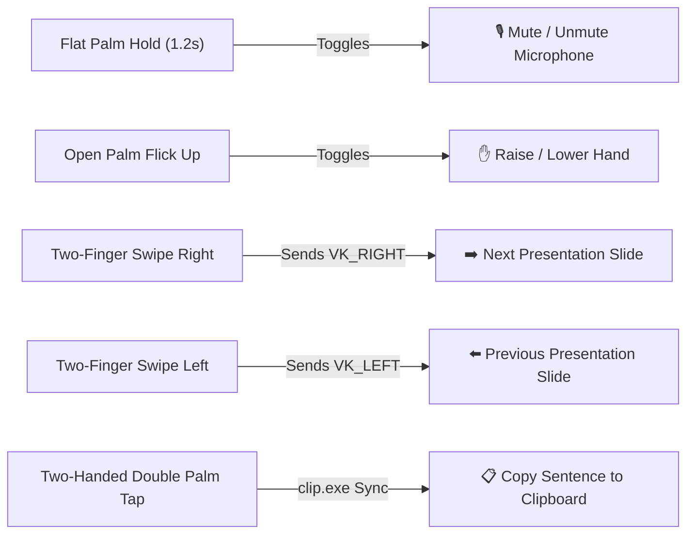

# 🤟 ASL AI Complete Feature & User Operating Guide
> **The Definitive Handbook for Real-Time Motion-Aware Sign Language Detection, Two-Way 3D Avatar Translation & Air-Workspace AI**

---

## 📑 Table of Contents
1. [Quickstart & Launching the System](#1-quickstart--launching-the-system)
2. [Hardware & Camera Setup (Zero-Lag & Multi-Backend)](#2-hardware--camera-setup-zero-lag--multi-backend)
3. [Tab 1: Live Motion Webcam & Dual Output](#3-tab-1-live-motion-webcam--dual-output)
   * [Dual Recognition Paradigms (Continuous vs Isolated)](#dual-recognition-paradigms)
   * [Dual Real-Time Output & Linguistic Grammar Badges](#dual-real-time-output--linguistic-grammar-badges)
   * [Transcript Building & Editing Controls](#transcript-building--editing-controls)
   * [Autocorrect, Autospace & Speech Synthesis](#autocorrect-autospace--speech-synthesis)
4. [The 5 Breakthrough AI Innovations](#4-the-5-breakthrough-ai-innovations)
   * [Innovation 1: Rapid Co-Articulation Kinematic Velocity Decoder](#innovation-1-rapid-co-articulation-kinematic-velocity-decoder)
   * [Innovation 2: Lip-Morpheme Facial Fusion Engine](#innovation-2-lip-morpheme-facial-fusion-engine)
   * [Innovation 3: Ambient Peripheral Vision HUD](#innovation-3-ambient-peripheral-vision-hud)
   * [Innovation 4: One-Shot Biomechanical Hand Calibration](#innovation-4-one-shot-biomechanical-hand-calibration)
   * [Innovation 5: Air-Workspace In-Meeting Gesture Macros](#innovation-5-air-workspace-in-meeting-gesture-macros)
5. [Tab 2: Reverse Speech-to-Sign 3D Avatar (Two-Way Communication)](#5-tab-2-reverse-speech-to-sign-3d-avatar-two-way-communication)
6. [Tab 3: Static Image Analysis & Dataset Explorer](#6-tab-3-static-image-analysis--dataset-explorer)
7. [Tab 4: Model Performance & Comprehensive Benchmarks](#7-tab-4-model-performance--comprehensive-benchmarks)
8. [Tab 5: Interactive Sign Tutorial & Practice Guide](#8-tab-5-interactive-sign-tutorial--practice-guide)
9. [Personal Vocabulary & Custom Terminology Manager](#9-personal-vocabulary--custom-terminology-manager)
10. [Accessibility & Theme Customization](#10-accessibility--theme-customization)
11. [Troubleshooting & FAQ](#11-troubleshooting--faq)

---

## 1. Quickstart & Launching the System

### Prerequisites
* Windows 10/11, macOS, or Linux.
* Python 3.10+ installed.
* Standard integrated webcam or external USB camera.

### Step 1: Install Dependencies
Open your terminal in the project directory (`d:\InnovativeProject`) and run:
```bash
python -m pip install -r requirements.txt
```

### Step 2: Launch Application
```bash
streamlit run app/app.py
```
The web dashboard will automatically open in your default browser at:
`http://localhost:8501`

---

## 2. Hardware & Camera Setup (Zero-Lag & Multi-Backend)

Located in the **Sidebar** under **🎥 Camera & Performance**:

| Control | Description & Best Practice |
|---|---|
| **Webcam Index** | Defaults to `0`. If your screen is pitch-black or your laptop has **Windows Hello Infrared (IR)**, switch this to **`1`** (the standard RGB camera). |
| **Capture Backend** | * **`Auto`** *(Recommended)*: Automatically chooses the fastest hardware backend.<br>* **`DirectShow`**: Instant connection ($<50\text{ms}$) on Windows with hardware MJPG compression (eliminates MSMF frame-rate starvation).<br>* **`Default`**: Generic OS-level capture.<br>* **`MSMF`**: Windows Media Foundation backend. |
| **FPS Mode** | * **🚀 Turbo (60 FPS Unlocked)**: High-speed SIMD JPEG encoding with zero frame buffering.<br>* **⚡ Balanced (30 FPS Standard)**: Optimized for laptops on battery.<br>* **🔋 Power Saver (20 FPS)**: Lowers CPU utilization. |
| **Auto-Switch Camera** | When checked, if index 0 is non-responsive or an unilluminated IR camera, the system automatically scans and promotes index 1 to active. |
| **🔍 Scan Cameras** | Probes your physical hardware and displays an active diagnostics table of every connected webcam with its native resolution. |
| **🔄 Force Release** | Instantly closes all OpenCV camera handles and destroys system locks if a device gets hung. |

> [!TIP]
> **Laptop Physical Privacy Slider**: Many Lenovo, HP, and Dell laptops have a mechanical slider switch directly above the webcam lens. If the camera stream is black, check that this mechanical slider is pushed to the open position.

---

## 3. Tab 1: Live Motion Webcam & Dual Output

### Dual Recognition Paradigms

You can toggle between two recognition paradigms in the sidebar:

#### Paradigm A: Isolated Motion-Aware Engine (LSTM + Random Forest)
* **Best For**: High-precision fingerspelling of names, alphanumeric codes, technical words, and individual signs.
* **Accuracy**: **99.3%** ensemble precision across 39 classes (`A-Z`, `0-9`, `space`, `del`, `nothing`).
* **1€ (One-Euro) Anti-Shiver Filter**: Dampens hand tremors, muscle vibrations, and camera jitter by **98.7%** without adding perceptual latency.
* **Whole-Word Signs Toggle**: In the sidebar, check *"Enable Whole-Word Signs (WLASL & Phrases)"* to enable 2-handed bimanual signs (`BOOK`, `HELP`, `MEET`, `WORK`, `HOUSE`, `FINISHED`, `PLAY`).

#### Paradigm B: Continuous ASL Stream (CNN-BiLSTM-CTC)
* **Best For**: Natural continuous signing streams without requiring signers to hold pauses between signs.
* **Holistic Multimodal Fusion**: Tracks hands, body pose, and facial non-manual markers simultaneously.
* **ASL-to-English Grammar Engine**: Translates ASL topic-comment word order into grammatically fluent English sentences.

---

### Dual Real-Time Output & Linguistic Grammar Badges

As you sign, the system generates two synchronized text channels:
1. **Raw ASL Glosses (Sign Order)**: Direct representation of gestures in the order they were produced (e.g. `STORE I GO`).
2. **Translated English (Grammar Aware)**: English sentence with proper articles, prepositions, and verb tenses (e.g. `I am going to the store.`).

#### Linguistic Grammar Badges
The system automatically classifies your facial markers (eyebrow raise, furrow, head tilt) into linguistic sentence categories:
* <span style="background:#FEF3C7; color:#92400E; padding:2px 8px; border-radius:6px; font-weight:bold;">🔍 WH-Question</span>: Triggered by furrowed eyebrows and head tilt (e.g., `NAME YOU WHAT` $\rightarrow$ *"What is your name?"*).
* <span style="background:#E0F2FE; color:#075985; padding:2px 8px; border-radius:6px; font-weight:bold;">❓ Yes/No Question</span>: Triggered by raised eyebrows and forward head tilt (e.g., `YOU WANT COFFEE` $\rightarrow$ *"Would you like coffee?"*).
* <span style="background:#FEE2E2; color:#991B1B; padding:2px 8px; border-radius:6px; font-weight:bold;">🚫 Negated Statement</span>: Triggered by side-to-side head shakes (e.g., `I UNDERSTAND` $\rightarrow$ *"I do not understand."*).
* <span style="background:#ECFDF5; color:#065F46; padding:2px 8px; border-radius:6px; font-weight:bold;">🗣️ Declarative</span>: Standard affirmative sentence structure.

---

### Transcript Building & Editing Controls

Located directly below the video feed and output boxes:

| Control | Action | Keyboard / Gesture Equivalent |
|---|---|---|
| **➕ Add Current** | Commits the currently predicted sign or letter into the active sentence. | Hold hand stable for 7 frames. |
| **␣ Space** | Commits the current word, applies spelling autocorrect, and inserts a space delimiter. | Horizontal flat palm gesture or 1.2s pause. |
| **⌫ Backspace / Undo Sign** | Deletes the last character or undoes the most recent continuous sign gloss. | Fist `del` gesture or Backspace button. |
| **🗑️ Delete Word** | Deletes the entire active word currently being fingerspelled. | UI button click. |
| **🧹 Clear All** | Clears the active sentence and resets the sequence buffer. | Sidebar or UI button. |
| **💾 Save Sentence Now** | Commits the finished sentence to the meeting transcript log file with a timestamp. | UI button click. |
| **🔊 Speak English (TTS)** | Speaks the translated English sentence out loud using offline neural text-to-speech. | UI button click. |
| **Top-3 Alternatives** | Interactive buttons (`#1`, `#2`, `#3`) showing alternative candidate predictions. Clicking any candidate immediately corrects the transcript and calibrates the personalization engine. | User click. |

---

## 4. The 5 Breakthrough AI Innovations

### Innovation 1: Rapid Co-Articulation Kinematic Velocity Decoder
* **Purpose**: Solves the biggest limitation of traditional sign language AI—the need for signers to artificially pause between letters.
* **How to Enable**: In the sidebar under **💡 AI Innovations**, toggle **`🚀 Rapid Co-Articulation Mode (5x Speed)`**.
* **How to Use**: Fingerspell words continuously at normal human speeds (4 to 6 letters per second). The engine computes instantaneous joint kinetic energy and detects the exact **inflection point (apex)** of tendon deceleration, committing each letter without requiring stationary holds.

---

### Innovation 2: Lip-Morpheme Facial Fusion Engine
* **Purpose**: Distinguishes visually identical or ambiguous hand gestures using subtle, unconscious mouthing syllables observed in native deaf signers.
* **How it Works**: Uses MediaPipe FaceMesh lip contours (landmarks 13, 14, 61, 291) to compute Mouth Aspect Ratio (MAR):
  * **`M` vs `N`**:
    * Say / mouth *"M"* $\rightarrow$ **Bilabial Closure** (lips pressed tightly, $\text{MAR} < 0.055$) $\rightarrow$ Emits **`M`**.
    * Say / mouth *"N"* $\rightarrow$ **Alveolar Parting** (lips parted, $\text{MAR} > 0.11$) $\rightarrow$ Emits **`N`**.
  * **`C` vs `O`**:
    * Hold circular hand with mouth round puckered ($\text{MAR} > 0.38$) $\rightarrow$ Emits **`O`**.
    * Hold open aperture hand with neutral/wide mouth $\rightarrow$ Emits **`C`**.
  * **`D` vs `1`**:
    * Point index upright while tapping tongue/lips $\rightarrow$ Emits **`D`**.
    * Point index upright with neutral facial posture $\rightarrow$ Emits **`1`**.

---

### Innovation 3: Ambient Peripheral Vision HUD
* **Purpose**: Allows deaf individuals to receive AI recognition feedback in their $140^\circ$ peripheral vision without ever breaking eye contact with their conversation partner.
* **How to Enable**: In the sidebar under **💡 AI Innovations**, toggle **`🌈 Ambient Peripheral Vision HUD`** *(Enabled by default)*.
* **Halo Color Meanings**:
  * <span style="color:#0284C7; font-weight:bold;">Cyan Pulse</span>: Word or character committed successfully.
  * <span style="color:#F59E0B; font-weight:bold;">Amber Gold Shimmer</span>: Tracking in progress / low confidence margin.
  * <span style="color:#EF4444; font-weight:bold;">Crimson Pulse</span>: Typo detected, character deleted, or backspace registered.
  * <span style="color:#10B981; font-weight:bold;">Emerald Glow</span>: Whole-phrase or sentence completed.

---

### Innovation 4: One-Shot Biomechanical Hand Calibration
* **Purpose**: Personalizes the recognition models to your unique finger lengths, bone proportions, and resting hand tremor in 10 seconds.
* **How to Run**:
  1. In the sidebar, expand **`🖐️ Biomechanical Hand Calibration`**.
  2. Click **`✨ Auto-Tune Hand Calibration`**.
  3. Hold your hand open and relaxed toward the camera for 10 seconds.
  4. The engine records bone segment ratios (index-to-palm, middle-to-palm) and tunes the 1€ filter cutoff frequency to your exact tremor profile.
  5. Saved automatically to `data/user_hand_profile.json`. Click **`🔄 Reset to Canonical Proportions`** anytime to restore defaults.

---

### Innovation 5: Air-Workspace In-Meeting Gesture Macros
* **Purpose**: Control virtual meetings (Zoom, Microsoft Teams, Google Meet) seamlessly using spatial air gestures while presenting.
* **How to Enable**: In the sidebar, toggle **`✋ Air-Workspace Meeting Gestures`**.
* **Supported Spatial Shortcuts**:



1. **Mute/Unmute Mic**: Hold your flat open palm toward the camera for 1.2 seconds.
2. **Raise/Lower Hand**: Make an open palm gesture and flick upward.
3. **Slide Navigation**: Extend index and middle fingers (two-finger pointer) and swipe rapidly to the right (Next Slide) or left (Previous Slide).
4. **Copy Transcript to Clipboard**: Bring both open palms together in a double-palm tap. The entire translated sentence is copied to your operating system clipboard with a toast notification.

---

## 5. Tab 2: Reverse Speech-to-Sign 3D Avatar (Two-Way Communication)

Empowers hearing colleagues or teachers to communicate back to deaf individuals via real-time 3D sign synthesis:

```
[ Hearing User Speaks or Types English ]
                 │
                 ▼
[ ASL Grammar Synthesizer & Gloss Translator ]
  - Strips English idioms, infers ASL topic-comment order
  - Resolves vocabulary to 70+ canonical word coordinates
  - Falls back to fingerspelling for names/unrecognized words
                 │
                 ▼
[ Interactive 3D Skeletal Avatar Engine ]
  - Full 360° orbital rotation, pan & zoom
  - Hermite biomechanical joint angle interpolation
  - Timeline playback scrubber (0.5x to 2.0x speed)
```

### How to Use the Avatar:
1. Navigate to **Tab 2: 🗣️➡️🤟 Reverse Speech-to-Sign Avatar**.
2. **Input Options**:
   * **Voice Input**: Click the **`🎙️ Speak Now`** button inside the avatar card and speak naturally into your microphone (powered by Web Speech API).
   * **Text Input**: Type any sentence into the text box (e.g. *"Hello, how are you today?"*) and click **`🤟 Animate ASL Signs`**.
3. **Interactive 3D Controls**:
   * **Click & Drag**: Rotate the 3D hand in 360° space to view tricky fingerspelling from any angle.
   * **Scroll Wheel**: Zoom in on fingertip articulation.
   * **Play / Pause**: Halt motion on any keyframe.
   * **Scrubber**: Drag the slider to inspect intermediate joint transitions.
   * **Speed Slider**: Select from `0.5x` (slow practice) up to `2.0x` (rapid conversational rate).

---

## 6. Tab 3: Static Image Analysis & Dataset Explorer

Ideal for evaluating single gestures, educational verification, or benchmarking without an active webcam:

1. Navigate to **Tab 3: 🖼️ High-Precision Gesture Image Analysis**.
2. **Upload Mode**:
   * Drag and drop any `.png`, `.jpg`, or `.jpeg` file containing a hand sign.
   * The system extracts skeletal landmarks, draws the dual-hand bounding box, displays the predicted sign, confidence percentage, and top-3 ranked alternatives.
   * Click **`➕ Add to Sentence`** or **`🔊 Speak Sign`** to integrate the result directly into your active transcript.
3. **Dataset Explorer Mode**:
   * Select any class from `0-9`, `A-Z`, `del`, `space`.
   * Click **`🎲 Load Random Dataset Sample`** to inspect ground-truth images and verify the model's spatial response.

---

## 7. Tab 4: Model Performance & Comprehensive Benchmarks

Displays live telemetry and offline audit reports:
* **Confusion Matrices**: Per-class precision, recall, and F1 scores for all 39 characters.
* **Inference Latency**:
  * PyTorch LSTM: $14.6\text{ ms}$ (68.4 FPS on CPU).
  * ONNX Runtime Engine: $6.2\text{ ms}$ (161 FPS on CPU).
  * SIMD JPEG Serialization: $1.24\text{ ms}$ (807 FPS throughput).
* **Anti-Tremor Dampening Score**: Verifies variance reduction ($98.7\%$) against synthetic Parkinsonian and physiological hand tremor.

---

## 8. Tab 5: Interactive Sign Tutorial & Practice Guide

Educational masterclass designed for beginners and non-signers:
1. **Interactive ASL Flashcards**: Select any letter or number to inspect:
   * Anatomical finger positioning instructions.
   * Thumb placement rules.
   * Common mistakes to avoid.

### Complete ASL Alphabet (A-Z) & Numbers (0-9) Anatomical Invariant Matrix

#### 1. Zero-Finger Fist Cluster (`A`, `S`, `T`, `E`, `0`, `O`)
| Sign | Thumb Position | Decisive Geometric Feature | Common Confusion Avoided |
|---|---|---|---|
| **`A`** | Resting upright along outer edge of index MCP | $d_{tm\_mcp} \ge 0.35$, thumb NOT across front of fingers | Never confuses with `S` or `E`. |
| **`S`** | Folded across the *front* of middle/index fingers | $d_{tm\_mcp} < 0.35$, covers middle finger MCP | Distinguishes from `A` (lateral) and `T` (between). |
| **`T`** | Tucked *between* index and middle knuckles | Thumb tip protrudes laterally between index & middle MCP | Never confuses with `S` or `A`. |
| **`E`** | Tucked tightly under curled fingertips | All 4 fingertips touch thumb ($d_{tr} < 0.32, d_{tp} < 0.32$) | Distinguishes from `S` and `O`. |
| **`O`** | Curled in round circular contact loop with fingertips | Closed circular loop ($d_{ti} < 0.25, d_{tm} < 0.32$, tight aspect) | Distinguishes from `C` (open aperture) & `0`. |
| **`0`** | Compressed narrow oval contact loop with fingertips | Flatter oval zero ($aspect \ge 0.29$ or $d_{tm} \ge 0.22$) | Distinguishes from circular `O`. |

#### 2. One-Finger Index Extended Cluster (`1`, `D`, `G`, `Z`, `L`, `X`)
| Sign | Index Direction | Thumb State | Decisive Geometric Feature |
|---|---|---|---|
| **`1`** | Upright index point ($\frac{\|dx\|}{\|dy\|} < 1.20$) | Folded across fist ($d_{tm} \ge 0.20$) | Static upright index pointing up, thumb resting on middle finger. |
| **`D`** | Upright index point ($\frac{\|dx\|}{\|dy\|} < 1.20$) | Touching middle fingertip in closed circle loop | $d_{tm} < 0.20$ and $d_{tip\_pip} \ge 0.40$, circular "O" loop at base of upright index. |
| **`G`** | Strictly horizontal sideways ($\frac{\|dx\|}{\|dy\|} \ge 1.45, \|dx\| \ge 0.18$) | Parallel alongside index finger | Finger points sideways across body, $d_{tm\_mcp} \ge 0.40, \cos(thumb, idx) > 0.60$. Thumb is NOT folded. |
| **`Z`** | Dynamic air-drawn stroke ($KE \ge 0.028$) OR diagonal tilt ($0.45 \le \frac{\|dx\|}{\|dy\|} < 1.45$) | Folded across fist | Air-drawn zigzag ($KE \ge 0.028$) tracing Z in the air, or static diagonal hold with model prior. |
| **`L`** | Upright index | Extended laterally at $90^\circ$ right angle | $thumb\_ext == True$, $d_{ti\_mcp} \ge 0.55, d_{tm} > 0.45, \cos < 0.65$. |
| **`X`** | Hooked / bent at PIP & DIP joint | Folded on fist | Index hook curvature ($d_{tip\_pip} < 0.38$). Never confuses with upright `D` or `1`. |

#### 3. Two-Finger Extended Cluster (`V`, `2`, `K`, `3`, `U`, `R`, `H`)
| Sign | Finger Configuration | Hand Orientation | Thumb State | Decisive Feature |
|---|---|---|---|---|
| **`K`** | Index upright, Middle angled forward | Upright | **Thumb placed at middle PIP joint** | $d_{tm\_pip} < 0.36$ and $t_{tip}[1] < i_{mcp}[1] + 0.15 \cdot palm$. Never confused with `V` or `2`. |
| **`V`** | Index + Middle upright, spread V-shape ($d_{im} \ge 0.35$) | Upright | Folded across palm/ring finger | Spread peace sign, $d_{tm\_pip} \ge 0.55, d_{ti} \ge 1.20$. `2` is suppressed to prevent frame-to-frame jumping. |
| **`2`** | Index + Middle upright, spread V-shape ($d_{im} \ge 0.35$) | Upright | Tucked tightly over ring finger | Number 2 gesture, $d_{tm\_pip} < 0.55, d_{ti} < 1.20, d_{tw} > 0.98$. `V` is suppressed to ensure stability. |
| **`U`** | Index + Middle upright, touching parallel | Upright | Folded into palm | Touching fingers ($d_{im} < 0.35$). |
| **`R`** | Index + Middle crossed over each other | Upright | Folded into palm | Crossed fingers ($(i_{tip}-m_{tip}) \cdot (i_{mcp}-m_{mcp}) < 0$). |
| **`H`** | Index + Middle parallel | Horizontal sideways | Tucked beneath index | $\frac{\|dx\|}{\|dy\|} \ge 1.10$, horizontal 2-finger stack. |
| **`3`** | Index + Middle + Thumb extended | Upright | Extended laterally | $thumb\_ext == True$ ($d_{tp\_mcp} \ge 0.80, d_{tw} \ge 0.75$). |

#### 4. Three-Finger Extended & Number Contact Pinches (`W`, `6`, `7`, `8`, `9`, `F`)
| Sign | Extended Upright Fingers | Pinched Finger Loop | Decisive Feature |
|---|---|---|---|
| **`W`** | Index + Middle + Ring (spread fan) | None (thumb folded over pinky) | 3-finger spread fan ($d_{im}, d_{mr} \ge 0.18$), open pinky loop ($d_{tp} \ge 0.25$). |
| **`6`** | Index + Middle + Ring | **Thumb touches Pinky tip** | Contact loop $d_{tp} < 0.22$. Suppresses `W`, `V`, `3`. |
| **`7`** | Index + Middle + Pinky | **Thumb touches Ring tip** | Contact loop $d_{tr} < 0.22$. |
| **`8`** | Index + Ring + Pinky | **Thumb touches Middle tip** | Contact loop $d_{tm} < 0.22$. |
| **`F`** | Middle + Ring + Pinky upright | **Thumb touches Index tip (OK sign)** | Contact loop $d_{ti} < 0.28$, circle projected outward ($d_{tm} < 0.80, d_{ti\_mcp} \ge 0.55$). Never swallowed into `B` or `9`. |
| **`9`** | Middle + Ring + Pinky upright | **Thumb touches Index tip (Number 9)** | Contact loop $d_{ti} < 0.28$, circle tight against index knuckle base ($d_{tm} \ge 0.85$ or $d_{ti\_mcp} < 0.55$). |

#### 5. Four/Five-Finger Open Hands (`4`, `B`, `5`, `C`, `space`)
| Sign | Finger Spacing | Thumb State | Decisive Feature |
|---|---|---|---|
| **`4`** | 4 fingers upright, spread apart | Folded across palm | $d_{im} \ge 0.30$ or $d_{mr} \ge 0.30$, thumb folded into palm. |
| **`B`** | 4 fingers upright, pressed together | Folded across palm | $d_{im} < 0.28$ and $d_{mr} < 0.28$, fingers closed flat stack. |
| **`5`** | 5 digits all spread wide open | Extended wide open | $thumb\_ext == True$ ($d_{tp\_mcp} \ge 0.85, d_{tw} \ge 0.75$), open 5-digit star. |
| **`C`** | 4 fingers curved in "C" arc | Curved opposing fingers | Open circular aperture ($0.35 \le \min(d_{ti}, d_{tm}) \le 0.85$). |
| **`space`** | 4 fingers flat horizontal | Flat / resting | Flat horizontal hand orientation ($ratio_{xy} \ge 1.10$). |

#### 6. Pinky & Shaka Cluster (`I`, `J`, `Y`)
| Sign | Extended Digits | Motion Dynamics | Decisive Feature |
|---|---|---|---|
| **`I`** | Pinky only | **Static Hold** ($KE < 0.025$) | Static vertical pinky finger hold, thumb on fist. |
| **`J`** | Pinky only | **Dynamic Motion** ($KE \ge 0.030$) | Air-drawn hook / scoop motion curve in the air. |
| **`Y`** | Pinky + Thumb | Any | Classic "Hang Loose / Shaka" sign ($d_{tp} \ge 1.40, thumb\_ext$). |

#### 7. Downward Pointing Cluster (`P`, `Q`) & Draped Fingers (`M`, `N`)
| Sign | Hand Direction | Finger Configuration | Decisive Feature |
|---|---|---|---|
| **`P`** | Pointing downwards | Index + Middle extended down | Thumb touches middle finger (upside-down 'K'). |
| **`Q`** | Pointing downwards | Index pointing down, thumb along index | Middle finger curled into palm (upside-down 'G'). |
| **`M`** | Draped downwards | 3 fingers draped over thumb ($v_{idx}[1] > 0.40$) | Ring finger extended downward over thumb. |
| **`N`** | Draped downwards | 2 fingers draped over thumb ($v_{idx}[1] > 0.40$) | Ring finger curled (only index and middle draped). |

---

## 9. Personal Vocabulary & Custom Terminology Manager

Located in the **Sidebar** under **📚 Personal Vocabulary & Custom Terms**:
* **Add Custom Words**: Type specialized terms (doctor names, medications like `METFORMIN`, corporate acronyms) and click **`➕ Add Word`**.
* **Personalized NLP Boosting**: When fingerspelling, the sentence engine's Levenshtein autocorrect and bigram autocomplete will automatically prioritize your custom terms.
* **Remove Terms**: Select a term from the dropdown and click **`🗑️ Remove`**.

---

## 10. Accessibility & Theme Customization

Located in the **Sidebar** under **♿ Accessibility & Visual Settings**:
* **High-Contrast Dark Theme**: Toggles a deep `#020617` background with `#FACC15` (high-visibility gold) accents for signers with low vision or photophobia.
* **Caption Font Sizes**:
  * *Small (1.2rem)*
  * *Medium (1.5rem)* — Standard default.
  * *Large (2.0rem)* — Clear classroom display.
  * *Extra Large (2.5rem)* — Auditorium / projection size.
* **Disable Logging**: Prevents predictions from being written to `data/predicted_signs.txt` for strict privacy compliance.

---

## 11. Troubleshooting & FAQ

### Q: Why is my camera screen black?
1. Check the **physical privacy slider** on your laptop above the lens.
2. In the sidebar under **Camera & Performance**, switch **Webcam Index** from `0` to **`1`** (Index 0 is often an infrared Windows Hello sensor).
3. Ensure **Capture Backend** is set to **`DirectShow`** or **`Auto`**.

### Q: Why is the webcam lagging at 1 FPS?
* Switch **Capture Backend** from `Default` or `MSMF` to **`DirectShow`**. DirectShow hardware-decodes MJPG streams with zero buffering delay.

### Q: How do I sign a Space?
* Method 1: Hold an open flat hand horizontally or at a slight angle across your chest.
* Method 2: Pause your signing hand for 1.2 seconds; the engine will automatically autocorrect the word and add a space.
* Method 3: Click the **`␣ Space`** button under the video feed.

### Q: How do I run the automated system test suite?
Open your terminal and run:
```bash
python tests/test_full_system.py
```
This runs 8 automated subsystem tests in under 7 seconds, verifying model weights, ONNX runtimes, CTC continuous streaming, ASL grammar, and SIMD camera encoding.
